======================================
Site and Relay Monitoring Architecture
======================================

This document describes how the components of a Checkmk site and a relay interact: how configuration reaches the relay, and how each monitoring scenario (scheduled and ad-hoc, passive and active checks, service discovery) flows between them.

At a glance
===========

The site never connects to a relay: the relay polls the site for its configuration and tasks over HTTPS, runs the checks next to the hosts, and pushes the results back.

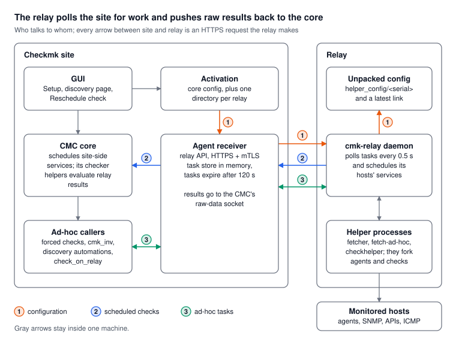

Three flows connect the two sides: configuration (1) and ad-hoc tasks (3) travel as tasks the relay polls for, scheduled results (2) as pushes into the CMC.
The relay only fetches and runs checks; the site's checker helpers compute every service state.

Site and relay map
==================

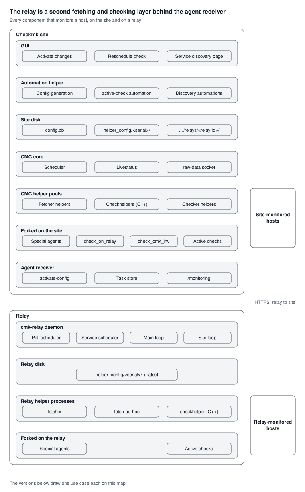

The site sits on top and the relay below; each row is one process or place, and the monitored hosts are on the right.
The seven versions after this map draw one use case each and gray out what it does not touch.

- **Automation helper:** a long-running process that runs the GUI's automations: config generation on activation, service discovery, and the discovery page's "execute active check".
  When it is switched off, the same automations run as ``cmk --automation`` subprocesses.
- **Site disk:** ``var/check_mk/core/``.
  ``config.pb`` is the CMC's config; ``helper_config/<serial>/`` holds the fetcher configs, secrets and CA bundle, and ``relays/<relay id>/`` inside it is one relay's share.
- **CMC helper pools:** fetcher helpers run ``@cmk`` jobs, checkhelpers run active checks, and checker helpers turn fetched data into service states.
- **Forked:** programs that a helper or an automation starts for one check: special agents, active check plugins, ``check_cmk_inv`` and ``check_on_relay``.

Use cases on the map
====================

Each version below draws one use case on the map: blue for a site-monitored host, orange for a relay-monitored host, black for the steps both share, and green for ``cmk_inv``.
Double arrows are a request and its answer.

Config generation
-----------------

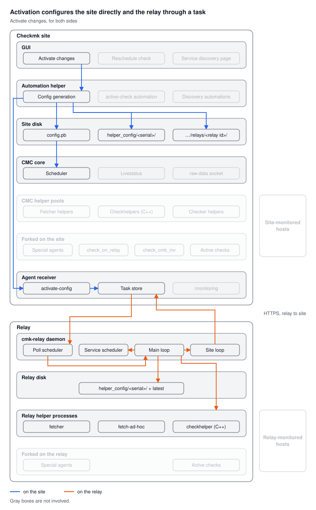

**On the site**

#. Activate changes runs the ``restart`` or ``reload`` automation, which generates the config.
#. It writes ``config.pb`` and ``helper_config/<serial>/``, with one ``relays/<relay id>/`` directory per relay inside.
#. The CMC reloads ``config.pb``; its fetcher helpers read ``helper_config/`` by serial.
#. Config generation posts to the agent receiver's ``activate-config`` endpoint.
#. The agent receiver tars each relay's directory into a ``RelayConfigTask`` in its task store.

In ``config.pb``, a relay host's active checks other than ``cmk_inv`` carry a ``check_on_relay`` command line, which the CMC runs only when someone forces the check.

**On the relay**

#. The poll scheduler picks up the task with its next poll.
#. The main loop has it unpacked to ``helper_config/<serial>/`` and moves ``latest``.
#. It applies the config: a new service schedule and resized helper pools.
#. The site loop reports "Config applied" back on the task.

Scheduled passive checks
------------------------

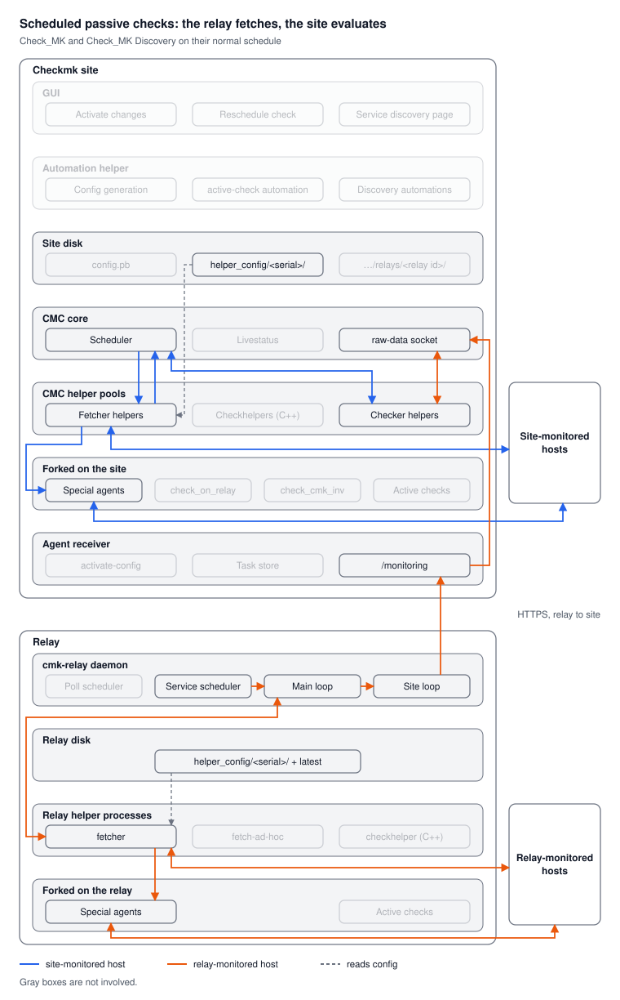

**Site-monitored host**

#. The CMC's scheduler hands the ``@cmk`` job to a fetcher helper, which reads the host's fetcher config from ``helper_config/<serial>/``.
#. The fetcher talks to the host directly (agent, SNMP) or forks a special agent.
#. The raw data goes back to the CMC, which hands it to a checker helper; the checker helper returns the service states.

**Relay-monitored host**

#. The relay's service scheduler queues a fetch task; the main loop hands it to a ``fetcher``, which reads the relay's copy of the config.
#. The fetcher talks to the host or forks a special agent from a relay-compatible plugin family.
#. The site loop pushes the raw data to ``/monitoring``, and the agent receiver writes it to the CMC's raw-data socket.
#. The CMC hands it to a checker helper, exactly as for a site host.

Scheduled active checks
-----------------------

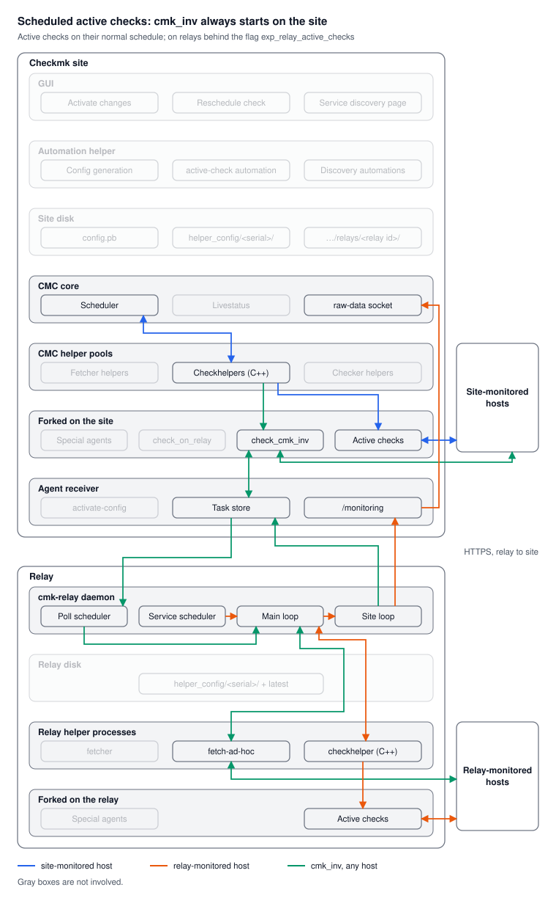

**Site-monitored host**

#. The CMC's scheduler hands the job to a checkhelper, which forks the active check plugin against the host and returns its result.

**HW/SW Inventory, any host** (``cmk_inv``)

#. ``cmk_inv`` is the one active check that always runs on the site: the CMC schedules it even for relay hosts, and a checkhelper forks ``check_cmk_inv``.
#. For a site host, ``check_cmk_inv`` fetches the data itself.
   For a relay host it sends a ``FetchAdHocTask`` and polls for the answer.
#. The relay runs that task in ``fetch-ad-hoc``.
   No secrets travel in the task, so the relay uses its own activated ones.
#. ``check_cmk_inv`` computes the inventory on the site and returns its result through the checkhelper.

**Relay-monitored host** (needs ``exp_relay_active_checks``)

#. The relay's service scheduler queues the check; the main loop hands it to a ``checkhelper``, which forks the plugin (``cert``, ``httpv2`` or ``icmp``).
#. The site loop pushes the result to ``/monitoring``, and the agent receiver writes it to the raw-data socket.
   The CMC takes it as final.

Rescheduled ad-hoc passive checks
---------------------------------

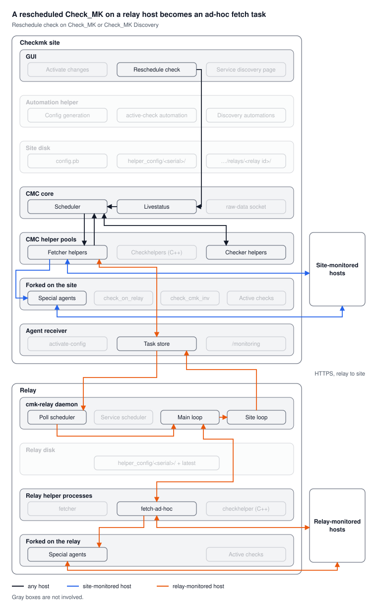

**Any host**

#. "Reschedule check" sends a forced-check command through Livestatus, and the CMC runs the job at once, outside its schedule.
   Rescheduling Check_MK Discovery forces Check_MK too.
#. A fetcher helper takes the ``@cmk`` job; its raw data goes to a checker helper as for a scheduled check.

**Site-monitored host:** the fetcher helper talks to the host or forks the special agent itself.

**Relay-monitored host**

#. The fetcher helper's relay trigger sends a ``FetchAdHocTask`` holding the serialized fetcher, and polls for the result.
#. The relay's poll scheduler picks the task up and ``fetch-ad-hoc`` runs it, forking the special agent when the fetcher is one.
   Only SNMP, special agent and piggyback fetchers work this way.
#. The site loop answers the task, and the fetcher helper's next poll gets the raw data.

Special agents do work here: a program fetcher is one of the three kinds an ad-hoc fetch supports.

Rescheduled ad-hoc active checks
--------------------------------

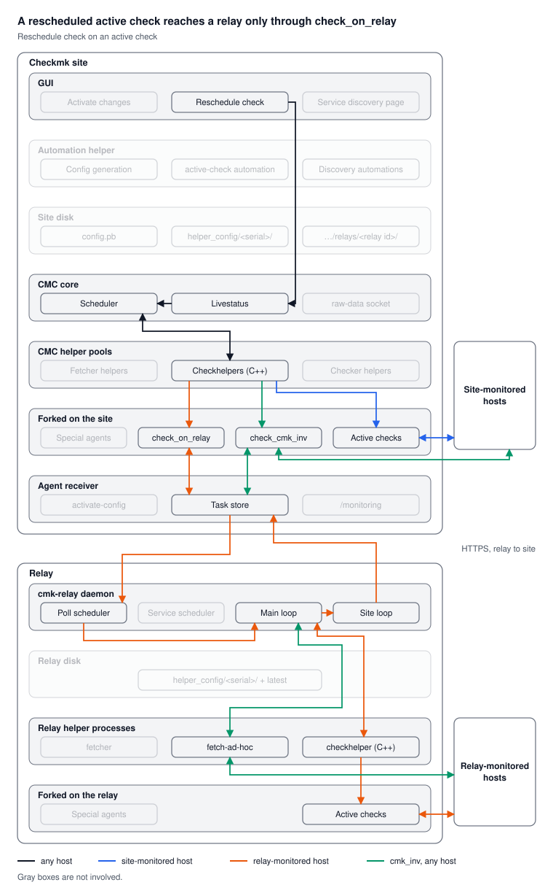

**Any host:** "Reschedule check" forces the job through Livestatus, and the CMC hands it to a checkhelper.

**Site-monitored host:** the checkhelper forks the plugin against the host.

**Relay-monitored host**

#. Config generation wraps the service's command line in ``check_on_relay``, which the checkhelper forks on the site.
#. ``check_on_relay`` sends an ``AdHocActiveCheckTask`` and waits up to the check's timeout plus 10 s.
#. The relay hands the task to its ``checkhelper``, which forks the plugin; the site loop answers the task.
#. ``check_on_relay`` turns the answer into the service's state and output.

The task carries no passwords or CAs: the relay runs the command against its applied configuration, as a scheduled run does.

``cmk_inv``: a reschedule only runs it now, the same way as on its schedule (see `Scheduled active checks`_).

Service discovery ad-hoc passive checks
---------------------------------------

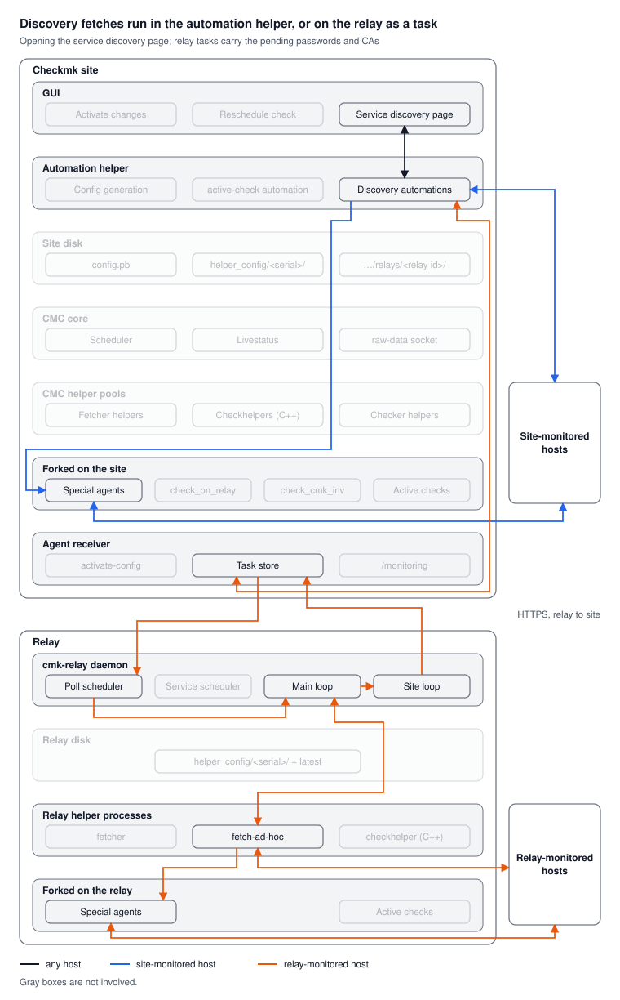

**Any host:** opening "Services of host X" runs the ``service-discovery-preview`` automation in the automation helper.
It fetches the host's data, computes the discovered services and their current results, and hands them to the page.
It works on the pending configuration: the Setup state with its passwords and CA bundle, not yet activated.

**Site-monitored host:** the automation fetches inside its own process: it talks to the host or forks the special agent itself.

**Relay-monitored host**

#. The automation's relay trigger sends a ``FetchAdHocTask`` carrying the fetcher plus the pending passwords and CA bundle, then polls for the answer.
#. The relay runs it in ``fetch-ad-hoc``, forking the special agent when the fetcher is one, and the site loop answers the task.
#. The automation computes the discovery on the site from that raw data, as for a site host.

Bulk discovery and the special agent preview take the same path.
The Check_MK Discovery service itself runs on the relay's schedule (see `Scheduled passive checks`_).

Service discovery ad-hoc active checks
--------------------------------------

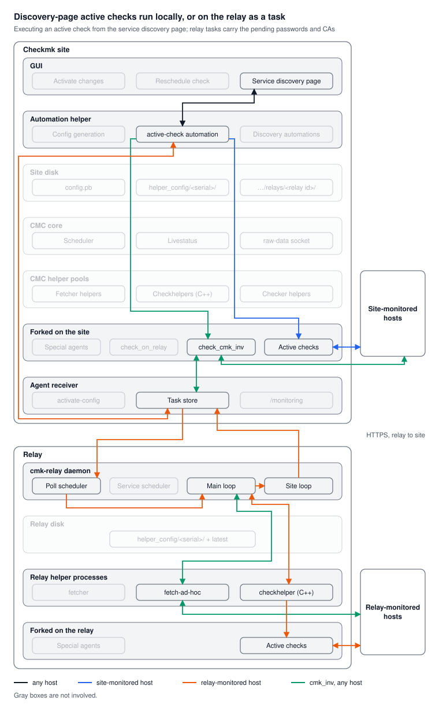

**Any host:** for each active check on the page, the GUI asks the ``active-check`` automation to run it now, with the pending passwords and CA bundle.

**Site-monitored host:** the automation runs the plugin itself, as its own subprocess.

``cmk_inv``, **any host:** it stays on the site even for a relay host.
The automation runs ``check_cmk_inv`` locally, which fetches the data itself or, for a relay host, through a ``FetchAdHocTask``.

**Relay-monitored host** (needs ``exp_relay_active_checks``)

#. The automation sends an ``AdHocActiveCheckTask`` carrying the command line, the pending passwords and the pending CA bundle, and waits up to the check's timeout plus 10 s.
#. The relay writes the passwords as a temporary password store, encrypted with its active store key, and the CA bundle as a temporary file that ``SSL_CERT_FILE`` points to for this command only.
#. Its ``checkhelper`` forks the plugin; the relay removes both files, and the site loop answers the task.

Without the flag, the page shows UNKNOWN: "Active check … is not supported on relays".

Configuration
=============

A relay gets its configuration as a task it polls for, never as a push: activation writes a directory per relay, the agent receiver packs it into a task, and the relay applies the newest one.

#. **Activate changes.**
   Core config generation writes the CMC config for every host, relay hosts included.
   For each service it also records whether the service runs on the site; for relay hosts only ``cmk_inv`` does.
   A relay host's other active checks get ``check_on_relay`` as their command line, which the CMC uses only when the check is forced.
#. **Write one directory per relay** under ``var/check_mk/core/helper_config/<serial>/relays/<relay id>/``, with only that relay's hosts:

   - ``engine/config.json``: pool sizes, log level, and each host's services with command, kind (``FETCHER`` for ``@cmk`` services, ``ACTIVE_CHECK`` otherwise), check periods, intervals, attempts and timeout.
   - ``fetchers/global_config.json`` and ``fetchers/hosts/<host>.json``: the fetcher configuration, special agent command lines included.
   - ``secrets/key`` and ``secrets/active_secrets``: only the passwords this relay's hosts reference.
   - ``ssl/ca-certificates.crt``: the trusted CAs.

#. **Notify the agent receiver.**
   ``notify_relay`` posts to ``/relays/activate-config``, only when relays are configured.
#. **Create a config task per relay.**
   The agent receiver tars each relay's directory into a ``RelayConfigTask(serial, tar)`` and keeps it in memory.
   It also creates one at its own startup, and whenever a relay polls with a serial (``X-CMK-SERIAL`` header) that differs from ``latest``.
   It never queues two tasks for the same serial.
#. **The relay polls** ``GET /relays/<id>/tasks?status=PENDING`` every 0.5 s.
   When several config tasks are pending, it applies the newest and answers the others with an error, "Outdated config update task".
#. **Unpack and apply.**
   The relay copies the archive to ``helper_config/<serial>/``, points ``latest`` at it, and keeps the two newest serials.
   The main loop then resizes the helper pools, replaces the service schedule, and reports "Config applied" back on the task.

The relay's fetchers read the unpacked config by serial, so a check scheduled under the old serial still finds its files while the new config is applied.

Scheduled path
==============

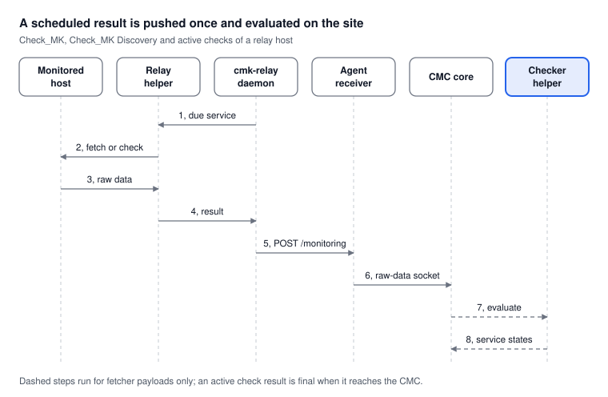

The relay schedules, fetches and pushes; the site evaluates.
Nothing goes back to the relay, so a lost push only shows as a stale service.

Ad-hoc path
===========

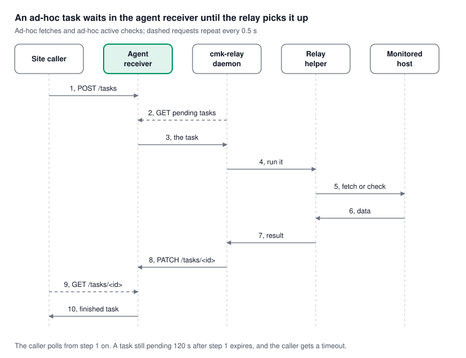

Every request crosses from the relay to the site, so the task waits in the agent receiver's memory until the relay's next poll.

Special cases
=============

The main picture hides limits and failure modes that explain most surprises.

**Host and service set**

- **No ping for relay hosts.**
  The host check becomes ``@service Check_MK``: the host's state follows the Check_MK service.
  No PING services are created.
- **Only relay-compatible special agents.**
  Agents from other plugin families are refused for relay hosts.
- **Custom checks are not supported** and stay pending.

**Ad-hoc tasks**

- **Ad-hoc fetches support only SNMP, special agent and piggyback fetchers.**
  Anything else fails with "This data source is not supported for relay hosts."

See Also
========

- :doc:`arch-comp-relay`: Relay system overview
- :doc:`arch-comp-relay-engine`: Relay engine architecture
- :doc:`arch-comp-relay-engine-concurrency`: Event loop, background loops, subprocess pools and threads
- :doc:`arch-comp-agent-receiver`: Agent receiver (includes relay endpoints)
