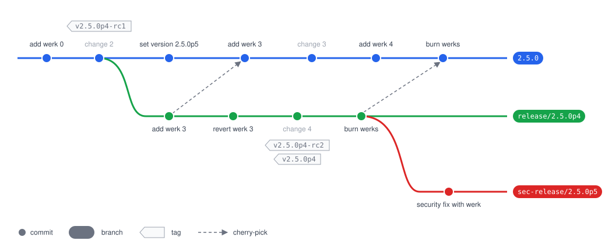

====================
Werk
====================

.. contents::
   :local:

A "Werk" (German for work) is a changelog element. Normally it is added with the
commit that implements the feature or fix. It holds a title, a description and
some metadata.

The metadata may also contain the Checkmk version when the change
connected to the Werk will be released. This is why a special tool is needed to
pick changes from one branch to another, so the version can be removed. [#]_

.. [#] The 2.4.0 branch still uses v2 Werks, which require a version. There,
   ``werk pick`` sets the version to the current version of the branch.

Versions
========

There are three different versions of Werk files (not to be confused with the
version field inside the Werk that specifies in which Checkmk version the Werk
was introduced!)

* markdown v3 (2.5 and higher)
    * uses the new edition names, e.g. "community" instead of "cre"
    * the version is optional
* markdown (2.3 and higher)
    * also called "v2" or "md"
    * Werk files end with ".md"
* nowiki (2.2 and below)
    * also called "classic", "legacy" or "v1"
    * Werk files have no file extension

Systems getting in touch with Werks
===================================

Release Process
---------------

Announcing
~~~~~~~~~~

A Mail and a Forum post is generated from the Werk files added in this version.

See ``announce`` sub-command of ``bazel run //cmk/utils:werks_bin`` (used by the
``announcement`` make-target).
Werks without a version count as Werks of the current version, see `Burn the Werks`_.

Burn the Werks
~~~~~~~~~~~~~~

Werks used to be created with a version. This version was only a best guess of
the release the Werk would ship with, and it caused many problems with releases
and security releases. [#]_ For details, see the
`RFC <https://docs.google.com/document/d/1sR69OpeAFn1Qmd4-Tgr3je2-eim5bUDXJd5wETOlSmA/edit>`__.

.. [#] For example, Werks picked onto the release branch ``release/A.B.CpX`` for
   a new release candidate needed a fix-up of their version field, and the
   version of the corresponding Werk in the upstream branch ``A.B.C`` had to be
   updated as well.

Now Werks are created without a version. Until a Werk is released, tools that
need its version use the current version of the branch, the ``VERSION`` in
``defines.make``. After the release, the released version is burned into the
Werk file, so the Werk keeps the version it shipped with.

After a final release, the Jenkins job ``buildscripts/scripts/burn-werks.groovy``
burns the released version into the Werks: on top of the release tag, it runs
the ``burn`` sub-command of ``bazel run //packages/cmk-werks:utils-bin``, which
writes the released version into every Werk without a version. The job picks
this commit onto the release branch and the version branch, and for the first
release of a version branch (e.g. 3.0.0b1) also onto master, as master contains
the same Werks.

The diagram shows the release of 2.5.0p4:

* Werk 0 is a boring standard feature/fix.
* Werk 3 is added on the release branch, but then reverted. It does not ship
  with 2.5.0p4.
* Werk 3 and Werk 4 are only on ``2.5.0``. The burn commit does not touch them:
  they keep no version until they are released and burned with 2.5.0p5.
* A security release has to start from the burn commit on the release branch,
  not from the release tag. Started from the tag, Werk 0 would have no version
  on ``sec-release/2.5.0p5``, and the burn after the security release would
  write 2.5.0p5 into it instead of 2.5.0p4.

This leaves a small inconsistency: the version of a Werk is resolved twice, on
two different code paths. The release itself is built from the tag
``v2.5.0p4``, where Werk 0 has no version yet, so precompile, announce, collect
and mail fill in the version on the fly. After the release, the burn commit
resolves the version again and writes it into the Werk file. Both steps have to
come to the same version for every Werk. Otherwise a Werk ships with one version
and is listed with another one afterwards.

Precompiled Werks
~~~~~~~~~~~~~~~~~

Precompiled Werks is the "database" (a json dump) that is shipped with Checkmk
which contains Werks relevant for this release.

Version 2.2 and below shipped Werks from all versions, suggesting that the
database shipped with Checkmk contains all Werks from all versions. But this is
not true. It only contains:

* all versions of the current major version
* all Werks that were added on the master branch (normally Werks assigned to the
  first beta release of a major version)
* some random Werks, which were probably added by accident

Version 2.3 and higher ship only Werks from the current major version.

Precompiled Werks consist of multiple files: one for each edition. It is created
while building Checkmk: Bazel rules in ``omd/packages/changelog/BUILD`` execute
``bazel run //packages/cmk-werks:utils-bin -- precompile`` for each edition.
Werks without a version get the current version, see `Burn the Werks`_.

Website
-------

You can search and filter Werks on the official Checkmk website: https://checkmk.com/werks

To compile a list of all Werks, you have to look for Werks in all branches of
Checkmk. This is done via ``bazel run //packages/cmk-werks:utils-bin -- collect``.
There is a jenkins job (``buildscripts/scripts/compile-all-werks.groovy``) that
executes this command in a 10 minutes interval. The command creates a json dump,
which will then be copied to the server hosting the homepage and read by a cron
job.

Beside the Checkmk git repository, also the repository for the Checkmk appliance and
the kubernetes repository contain Werks (robotmk will join this club eventually).
As all of them have different configuration and version numbers you have to
specify the flavor for collecting Werks from there. In the jenkins job those
json dumps are joined to one big json dump.

One Werk can be specified in multiple branches potentially with different content.
Higher versions and finally the master branch will always overwrite others.
Werks without a version get the current version of their branch, see `Burn the Werks`_.

Mailing-lists
-------------

In Werks you can specify the impact of a change via the "level" metadata. There
are three levels (1=trivial change, 3=big impact), for each of those levels a
mailing-list exists. An additional security mailing-list is also available (each
Werk is either a fix, a feature or security related).

The mails are sent via the ``mail`` sub-command of ``bazel run //cmk/utils:werks_bin``. The command is
executed daily on jenkins for each currently supported branch. It sends mails
directly to the mailing-list addresses.
For Werks without a version, the mail uses the base version of the branch (e.g. 2.5.0), see `Burn the Werks`_.

Each and every edit on a Werk will result in at least one mail to the
mailing lists. So if you need to modify many (>10) Werks, you should think about
disabling sending mails. The normal workflow for that is:

* ask IT-Admins to add you to the moderators of the Werk mailing lists
* ask IT-Admins to enable emergency moderation of all Werk mailing lists
* (optional) wait one day to see if this works correctly
* merge your mass editing Werks change
* wait one day until the cron job runs
* reject unwanted mails on the mailing list
* ask IT-Admins to disable emergency moderation

If a mail was sent for a particular commit is saved in git notes.

Checkmk
-------

Checkmk also includes a Werk browser which reads the precompiled Werks created
during the build process.

Werks can be marked as incompatible. This means that the user has to do
something in their Checkmk installation if they use the feature that was
modified with this Werk. In order to keep track of the to-dos, incompatible Werks
need to be acknowledged.

Pre 2.5.0, when updating to the next major version the user is warned when there are still
unacknowledged Werks from the previous version: Those can not be displayed in
the updated Checkmk, as it only ships with Werks from the current major version.
This is also why Checkmk 2.3.0 still needs code to read v1 Werks from the
precompiled Werks file: The code warning about the unacknowledged Werks is
executed from 2.3.0, but reads the Werks and unacknowledged Werks from a 2.2.0
site.

Since 2.5.0 the unacknowledged Werks are migrated to the updated site, see
`Werk #15365`_

.. _Werk #15365: https://checkmk.com/werk/15365

Werk-tool
---------

The source of all Werks are files. You can create, grep and edit them via normal
tools, but there is also a specialized helper called ``werk``. It lives in
``/packages/cmk-werks/``. It is used to pick Werks between version branches, and
can pick from branches using v1 Werks and automatically transform them to v3
Werks if the destination branch has markdown Werks enabled.

There are also some convenience functions to grep, list or edit Werks from the
command-line.

Technical background
====================

Reading Werks from disk is a two step process: first the file is parsed (meta
data is translated to a key-value structure, description is handled as a blob)
and then it is loaded (meta-data is validated and markdown/nowiki is transformed
to html).
This has the benefit that parsing a Werk is quite fast, but loading it can be
slow. For listing or grepping Werks it does not have to be validated and also
the description does not have to be interpreted, so parsing is enough in those instances.

There is no loading function for Werk v1 files: Those files are parsed, then
transformed to v2 files and then again parsed and loaded as Werk v2 files. This
way there is no difference if the file is automatically translated to markdown
and written to disk as markdown file, or loaded from v1 files and automatically
translated. They are exactly the same.
