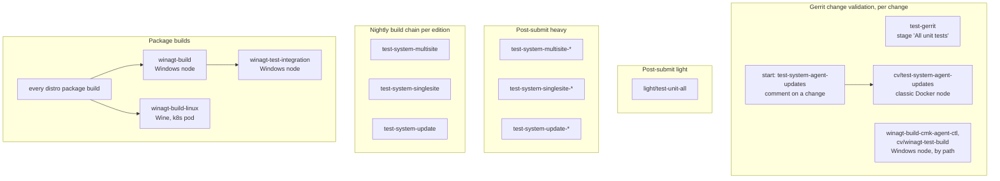

# Agent controller CI jobs

The job paths below are relative to the Jenkins folder of the branch. This document describes the
**master** wiring.

## Trigger topology

## Per change: Gerrit change validation

| Job                                             | What concerns the controller                                         | Where               |
| :---------------------------------------------- | :------------------------------------------------------------------- | :------------------ |
| `cv/test-gerrit-single`, stage "All unit tests" | the Linux Rust tests and the Python unit tests around the controller | Kubernetes pod      |
| `cv/test-system-agent-updates`                  | the suite `tests/system/agent_updates/`                              | classic Docker node |
| `winagt-build-cmk-agent-ctl`                    | builds the controller and runs its Rust tests on Windows             | Windows node        |
| `cv/winagt-test-build`                          | builds the Windows agent, `watest` included                          | Windows node        |

- **Every change** runs the Linux Rust tests and the Python unit tests. No stage depends on the
  controller's paths.
- **The Windows tests run natively** in `winagt-build-cmk-agent-ctl` and `cv/winagt-test-build`.
  Jenkins starts both for changes whose paths their job definitions select, for example under
  `packages/cmk-agent-ctl/`. `winagt-build-cmk-agent-ctl` does not vote. Under Wine, the tests do
  not run here.
- **`cv/test-system-agent-updates`** runs only when someone posts
  `start: test-system-agent-updates` on a change. It runs on `ubuntu-24.04` with the Pro
  edition, so it tests the baked deb.
- **The suite tests the baked package.** The unbaked package, built from `agents/BUILD`,
  `agents/debian/` and the `.spec` files, is not tested.

## Post-submit light

`light/test-unit-all` runs the same unit tests as change validation, in a Kubernetes pod.

## Post-submit heavy and nightly

The heavy trigger and the nightly build chain of each edition run these suites. All of them run in
a Kubernetes pod.

| Jobs                       | Suites that concern the controller                                                                                                      |
| :------------------------- | :-------------------------------------------------------------------------------------------------------------------------------------- |
| `test-system-multisite-*`  | `tests/system/multisite/agents/` and `tests/system/multisite/controller_site_interactions/`: registration and status against real sites |
| `test-system-singlesite-*` | suites that install the agent as a prerequisite                                                                                         |
| `test-system-update-*`     | the update test, which installs the agent around a site update                                                                          |

None of these jobs runs with faked artifacts. In the Pro jobs, the cases that need the Ultimate
edition skip themselves.

## Package builds

Every distro package build provides the Windows agent binaries. That runs the Windows side of the
controller's tests:

| Job                  | What concerns the controller                                                        | Where          |
| :------------------- | :---------------------------------------------------------------------------------- | :------------- |
| `winagt-build`       | builds the Windows agent and the controller and runs their tests, `watest` included | Windows node   |
| `winagt-build-linux` | runs the same tests under Wine                                                      | Kubernetes pod |

After each `winagt-build`, `winagt-test-integration` runs the Windows agent's integration tests.
