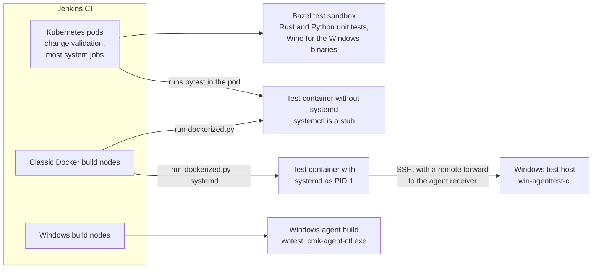

# Agent controller test systems

## Topology



## The systems

| System                         | Used by                                                           |
| :----------------------------- | :---------------------------------------------------------------- |
| Bazel test sandbox             | the Rust and Python unit tests, the Rust integration tests        |
| Wine in the Bazel sandbox      | the Windows test binaries of the controller and the Windows agent |
| Test container without systemd | the multisite and singlesite suites                               |
| Test container with systemd    | `non-free/tests/system/agent_updates/`                            |
| Windows build nodes            | the Windows agent and controller builds, with their tests         |
| Windows test host              | `non-free/tests/system/agent_updates/windows/`                    |

<!-- TODO: add the virtual machine for cases that need kernel enforcement, once it exists. -->

## Why the agent update tests need systemd

The agent package deploys systemd units and activates them when it is installed, see
`agents/scripts/super-server/0_systemd/`. A test container without systemd replaces `systemctl` by
a stub, so the package installs, but none of the activation happens. Without systemd, no test can
see whether the units are enabled and started, whether the socket gets the right owner and mode,
whether the controller's sandboxing works, or what an upgrade or an uninstall does to them.

## The test container with systemd

`tests/scripts/run-dockerized.py --systemd` boots systemd as PID 1 in the test container. It
supports Debian, Ubuntu and AlmaLinux. The comments in
`tests/testlib/system/script_helpers/dockerized_execution.py` explain how.

The container gets a private cgroup namespace and a tmpfs on `/run`, and it runs without Docker's
init. It needs no privilege beyond `SYS_ADMIN` and `apparmor:unconfined`, which every test
container already has.

In CI it needs a classic Docker build node, because on the Kubernetes path pytest runs inside the
pod and starts no container of its own. Whatever machine runs it needs Docker 20.10 or newer, for
the private cgroup namespace, and cgroup v2.

## Running the suite with systemd locally

The command is the same as in CI:

```bash
non-free/tests/run_tests.sh test-system-agent-updates-docker
```

These environment variables select what is tested:

| Variable      | Selects                                                                       |
| :------------ | :---------------------------------------------------------------------------- |
| `EDITION`     | the Checkmk edition, for example `pro` or `community`                         |
| `VERSION`     | the Checkmk version, by default the daily build of the branch                 |
| `DISTRO`      | the distribution of the test container: Debian, Ubuntu or AlmaLinux           |
| `TEST_FILTER` | extra pytest arguments, for example `-k test_installed_agent_reports_data`    |
| `RESULT_PATH` | the directory the results are copied to, by default a new temporary directory |

The first run for a version builds the test image, which takes several minutes. Later runs reuse
it.

Besides the JUnit report, the results contain `systemd/journal.txt` and
`systemd/failed-units.txt`. They show what systemd did during the run, also when a case failed
before it could log anything.

To look around in the container yourself, open a shell in it:

```bash
non-free/tests/run_tests.sh test-system-agent-updates-docker-debug
```

systemd runs as PID 1 in that shell's container, so `systemctl` and `journalctl` work.
`non-free/tests/run_tests.sh test-system-agent-updates` runs the suite from there.

## The Windows test host

The tests in `non-free/tests/system/agent_updates/windows/` install the Windows agent from its
MSI and register the controller with a site. Wine cannot run an MSI installation or the agent
service, so these tests need a real Windows host. One shared host serves every run.

### The host

| Property | Value                                                         |
| :------- | :------------------------------------------------------------ |
| Name     | `win-agenttest-ci.lan.checkmk.net`                            |
| Shell    | Windows OpenSSH. Its default shell is Windows PowerShell 5.1. |
| Locale   | `de-DE`. Windows tools print numbers with a decimal comma.    |

The host has no Python and no git. The tests drive it from the test container.

The owner, the logins and the maintenance of the host are described in
`non-free/tests/system/agent_updates/windows/README.md`.

### How a run uses the host

The fixtures in `windows/conftest.py` prepare the host once per run:

1. Connect to the host over SSH. A remote forward on that connection lets the host reach the
   agent receiver of the site in the test container. The host needs no route to the build node.
2. Let the site bake the agent MSI, and download the MSI.
3. Take the lock of the host.
4. Remove what an earlier run left behind. Then install the MSI and register the controller
   through the forward.
5. After the tests, remove the agent again and release the lock.

The run downloads the MSI before it takes the lock, so that it holds the lock only for a few
minutes. The PowerShell scripts that do the work on the host lie in `windows/scripts/`. A test
reaches the host through `WindowsHost` in `tests/testlib/system/windows_host.py`.

### The lock

One run at a time uses the host. The lock script `windows/scripts/hold_lock.ps1` of that run holds
the file `C:\cmk-test\host.lock` open. `C:\cmk-test\host.lock.owner` names the build or the
machine of the run.

A second run waits up to 10 minutes. Then it fails with "busy" and the holder of the lock.

The lock ends with the SSH session of its run, and after 30 minutes at the latest. A run whose
lock has expired fails with "lost the lock" at its next step on the host.

### The variables of a run

| Variable                   | Effect                                           |
| :------------------------- | :----------------------------------------------- |
| `QA_WINDOWS_HOST_SSH_KEY`  | The path to the key file. Unset, the tests skip. |
| `QA_WINDOWS_HOST_SSH_USER` | The account on the host, by default `jenkins`.   |

While the host is out of service, set `WINDOWS_HOST_OUT_OF_SERVICE` in `windows/_windows.py` to a
reason, and merge that change. The tests then skip and report the reason. In every other case the
tests run, and they fail when the host does not answer.
