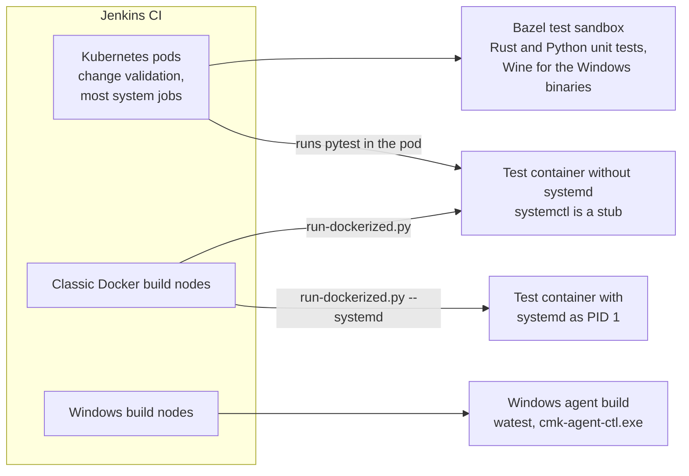

# Agent controller test systems

## Topology



## The systems

| System                         | Used by                                                           |
| :----------------------------- | :---------------------------------------------------------------- |
| Bazel test sandbox             | the Rust and Python unit tests, the Rust integration tests        |
| Wine in the Bazel sandbox      | the Windows test binaries of the controller and the Windows agent |
| Test container without systemd | the multisite and singlesite suites                               |
| Test container with systemd    | `tests/system/agent_updates/`                                     |
| Windows build nodes            | the Windows agent and controller builds, with their tests         |

<!-- TODO: add the virtual machine for cases that need kernel enforcement, and Windows end to end, once it exists. -->

## Why the agent update tests need systemd

The agent package deploys systemd units and activates them when it is installed, see
`agents/scripts/super-server/0_systemd/`. A test container without systemd replaces `systemctl` by
a stub, so the package installs, but none of the activation happens. Without systemd, no test can
see whether the units are enabled and started, whether the socket gets the right owner and mode,
whether the controller's sandboxing works, or what an upgrade or an uninstall does to them.

## The test container with systemd

`tests/scripts/run-dockerized.py --systemd` boots systemd as PID 1 in the test container. It
supports Debian, Ubuntu and AlmaLinux. The comments in
`tests/testlib/system/script_helpers/dockerized_execution.py` explain how.

The container gets a private cgroup namespace and a tmpfs on `/run`, and it runs without Docker's
init. It needs no privilege beyond `SYS_ADMIN` and `apparmor:unconfined`, which every test
container already has.

In CI it needs a classic Docker build node, because on the Kubernetes path pytest runs inside the
pod and starts no container of its own. Whatever machine runs it needs Docker 20.10 or newer, for
the private cgroup namespace, and cgroup v2.

## Running the suite with systemd locally

The command is the same as in CI:

```bash
tests/run_tests.sh test-system-agent-updates-docker
```

These environment variables select what is tested:

| Variable      | Selects                                                                       |
| :------------ | :---------------------------------------------------------------------------- |
| `EDITION`     | the Checkmk edition, for example `pro` or `community`                         |
| `VERSION`     | the Checkmk version, by default the daily build of the branch                 |
| `DISTRO`      | the distribution of the test container: Debian, Ubuntu or AlmaLinux           |
| `TEST_FILTER` | extra pytest arguments, for example `-k test_installed_agent_reports_data`    |
| `RESULT_PATH` | the directory the results are copied to, by default a new temporary directory |

The first run for a version builds the test image, which takes several minutes. Later runs reuse
it.

Besides the JUnit report, the results contain `systemd/journal.txt` and
`systemd/failed-units.txt`. They show what systemd did during the run, also when a case failed
before it could log anything.

To look around in the container yourself, open a shell in it:

```bash
tests/run_tests.sh test-system-agent-updates-docker-debug
```

systemd runs as PID 1 in that shell's container, so `systemctl` and `journalctl` work.
`tests/run_tests.sh test-system-agent-updates` runs the suite from there.
